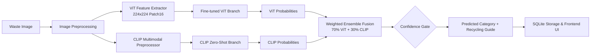

# EcoSort AI — Smart Waste Segregation Using Vision Transformer Ensemble and Foundation Models

An academic-grade, production-style intelligent waste classification system. EcoSort AI combines a **fine-tuned Vision Transformer (ViT)** (`google/vit-base-patch16-224-in21k`) with a **zero-shot CLIP foundation model** (`openai/clip-vit-base-patch32`) in a calibrated, weighted ensemble (70% ViT / 30% CLIP) to classify waste images into six standard categories and provide actionable recycling recommendations.

---

## 🎨 Visual Identity & Stitch Design

EcoSort AI adheres to a cohesive eco-tech visual system:
- **Forest Green**: `#14532D` (Header accents, typography emphasis)
- **Emerald Green**: `#16A34A` (Primary interactive elements, active states)
- **Lime Accent**: `#D9F99D` (Highlights, status pills, badges)
- **Background**: `#F7F9F5` (Clean, non-glare canvas)
- **Cards**: Pure White (`#FFFFFF`) with subtle slate borders
- **Typography**: **Manrope** for headings and brand elements, **Inter** for UI controls and body text.

---

## 🏗️ System Architecture



---

## 📂 Project Structure

```
smart-waste-segregation/
├── frontend/                     # React + TypeScript + Vite + Tailwind CSS
│   ├── public/                   # Static assets
│   ├── src/
│   │   ├── components/
│   │   │   ├── classify/         # Drag-and-drop uploader, ResultCard
│   │   │   ├── dashboard/        # CategoryChart, RecentTable, StatsCard
│   │   │   ├── history/          # Paginated history view
│   │   │   ├── layout/           # Sidebar, Navbar, Layout shell
│   │   │   ├── performance/      # ConfusionMatrix, LossChart, MetricsOverview
│   │   │   └── ui/               # shadcn/ui primitives
│   │   ├── pages/                # DashboardPage, ClassifyPage, HistoryPage, PerformancePage
│   │   ├── services/             # Axios API client
│   │   ├── test/                 # Component and unit tests
│   │   ├── types/                # Strict TypeScript interfaces
│   │   ├── App.tsx               # Client router
│   │   └── main.tsx              # React entry point
│   ├── index.html
│   ├── tailwind.config.ts
│   ├── vite.config.ts
│   └── package.json
│
├── backend/                      # FastAPI async REST service
│   ├── app/
│   │   ├── api/                  # Routes: health, model-info, predict, history, stats, metrics
│   │   ├── core/                 # Settings and dependency injection
│   │   ├── database/             # SQLAlchemy async engine & ORM models
│   │   ├── ml/                   # ViT, CLIP, Preprocessor, Ensemble engine
│   │   ├── schemas/              # Pydantic request/response schemas
│   │   ├── services/             # Recommendation logic & DB CRUD
│   │   └── main.py               # FastAPI application with lifespan loader
│   ├── training/                 # TrashNet dataset splitter, augmentation & ViT fine-tuner
│   ├── evaluation/               # Metric evaluator, confusion matrix plotter
│   ├── tests/                    # pytest suite
│   ├── uploads/                  # Temporary image storage (gitignored)
│   ├── models/                   # Model checkpoints (gitignored)
│   ├── data/                     # Dataset storage (gitignored)
│   ├── .env.example              # Backend environment template
│   ├── pytest.ini                # Test runner configuration
│   └── requirements.txt          # Complete Python dependencies
│
├── docs/                         # Technical documentation
│   ├── architecture.md           # System architecture specification
│   ├── api-reference.md          # Complete REST API reference
│   └── training-guide.md         # TrashNet download, fine-tuning & evaluation guide
│
├── .env.example                  # Master environment template
├── .gitignore                    # Clean Git exclusions
└── README.md                     # Project documentation
```

---

## ⚙️ Configuration & Environment Variables

Create `.env` by copying `.env.example`:

| Variable | Default Value | Description |
|----------|---------------|-------------|
| `APP_HOST` | `0.0.0.0` | Server bind interface |
| `APP_PORT` | `8000` | Server bind port |
| `DEBUG` | `false` | Enable SQL query echo and debug logs |
| `CORS_ORIGINS` | `["http://localhost:5173"]` | Allowed frontend origins |
| `DATABASE_URL` | `sqlite+aiosqlite:///./waste_segregation.db` | SQLite async connection string |
| `MAX_FILE_SIZE_MB` | `10` | Maximum uploaded image size |
| `UPLOAD_DIR` | `uploads` | Image upload directory |
| `MODELS_DIR` | `models` | Local checkpoint directory |
| `VIT_CHECKPOINT` | `google/vit-base-patch16-224-in21k` | Base ViT checkpoint |
| `VIT_FINETUNED_PATH` | `models/vit_waste_best.pt` | Path to fine-tuned ViT weights |
| `CLIP_CHECKPOINT` | `openai/clip-vit-base-patch32` | CLIP foundation model checkpoint |
| `ENSEMBLE_VIT_WEIGHT` | `0.70` | Weight assigned to ViT probabilities |
| `ENSEMBLE_CLIP_WEIGHT` | `0.30` | Weight assigned to CLIP probabilities |
| `MODEL_VERSION` | `1.0.0` | Semantic version logged with predictions |

---

## 🚀 Execution & Verification

### 1. Backend Setup

```bash
cd backend

# Create virtual environment
python -m venv .venv
.venv\Scripts\activate        # On Windows
# source .venv/bin/activate   # On Linux/macOS

# Install dependencies
pip install -r requirements.txt

# Start backend server
uvicorn app.main:app --reload --host 0.0.0.0 --port 8000
```

Verify backend health:
- Browser / cURL: `http://localhost:8000/api/health`
- Swagger UI: `http://localhost:8000/api/docs`

### 2. Frontend Setup

```bash
cd frontend

# Install packages
npm install

# Run development server
npm run dev
```

Open `http://localhost:5173` in your browser.

---

## 🧪 Testing

### Backend Test Suite
```bash
cd backend
pytest tests/ -v
```
Verifies ensemble probability fusion, weight normalization, confidence scoring, image validation, health checks, and 503 guardrails.

### Frontend Test Suite
```bash
cd frontend
npm test
```
Verifies React component rendering and UI contracts via Vitest and React Testing Library.

---

## 🏷️ Waste Categories

1. **Cardboard**
2. **Glass**
3. **Metal**
4. **Paper**
5. **Plastic**
6. **Trash**

---

## 📋 Implementation Roadmap

| Phase | Milestone | Status |
|-------|-----------|--------|
| **Phase 1** | **Project Architecture & Folder Structure** | **COMPLETED** |
| Phase 2 | Backend Setup & Database Persistence | Pending |
| Phase 3 | Dataset Preparation & Augmentation | Pending |
| Phase 4 | Vision Transformer Fine-Tuning | Pending |
| Phase 5 | CLIP Foundation Model Integration | Pending |
| Phase 6 | Ensemble Prediction Engine | Pending |
| Phase 7 | Frontend UI/UX Refinement | Pending |
| Phase 8 | Frontend-Backend Integration | Pending |
| Phase 9 | Model Evaluation & Performance Testing | Pending |
| Phase 10 | Final Verification & Packaging | Pending |
