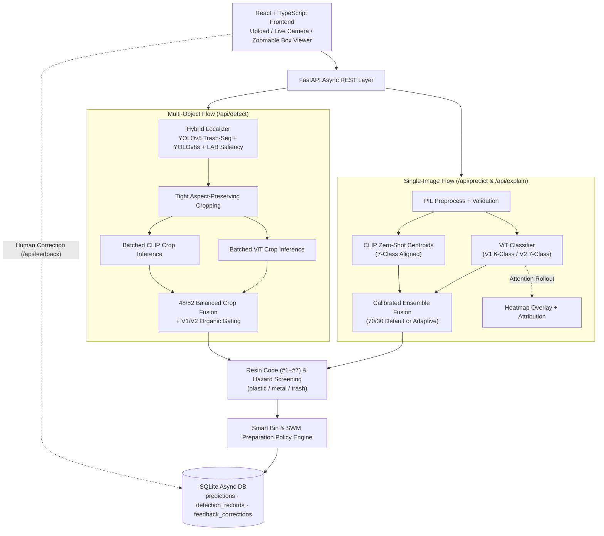

<div align="center">

# 🌿 EcoSort AI
### Smart Waste Segregation Using Vision Transformer Ensemble, Foundation Models, Explainable AI & Multi-Object Detection

[](https://www.python.org/)
[](https://fastapi.tiangolo.com/)
[](https://pytorch.org/)
[](https://huggingface.co/)
[](https://react.dev/)
[](https://vitejs.dev/)
[](https://www.sqlite.org/)

*Combining a fine-tuned Vision Transformer (`google/vit-base-patch16-224-in21k`), a zero-shot CLIP foundation model (`openai/clip-vit-base-patch32`), ViT attention rollout XAI, YOLOv8 hybrid multi-object localization, polymer resin code screening, and a human-in-the-loop recycling policy engine.*

[System Architecture](#-system-architecture) · [Key Features](#-key-features) · [Verified Benchmarks](#-verified-benchmarks) · [Quick Start](#-quick-start) · [API Reference](#-api-reference) · [Training & TACO Ingestion](#-training--taco-ingestion)

</div>

---

## 📌 Overview

Manual waste segregation is slow, inconsistent, and error-prone—cross-contaminating dry recyclables with organic wet waste or hazardous items. **EcoSort AI** upgrades single-model image classification into a full-stack, confidence-aware **7-class intelligent waste segregation platform** spanning:

- **6 Standard Recyclables & Residual Classes (V1):** `cardboard`, `glass`, `metal`, `paper`, `plastic`, `trash`
- **Compostable Organics Extension (V2/V3):** `organic` (validated via CLIP V2 class-centroid scoring and fine-tuned ViT V2 checkpoints without damaging V1 weights)
- **Mixed-Scene Multi-Object Detection (V3):** Isolates overlapping or cluttered items first, then classifies each cropped object independently through batched ViT + CLIP inference.

---

## ✨ Key Features

| Module | What It Does | Implementation |
|---|---|---|
| **Weighted Vision Ensemble** | Fuses fine-tuned `ViT-Base-Patch16` + zero-shot `CLIP-ViT-Base-Patch32` centroids with V1/V2 schema compatibility (`+Organic` bypass gating) and temperature calibration (`T = 0.35`). | [`ensemble.py`](backend/app/ml/ensemble.py), [`calibration.py`](backend/app/ml/calibration.py) |
| **Hybrid Multi-Object Detection** | Decouples localization (*WHERE* via `yolov8m_trash_seg.pt` + `yolov8s.pt` + residual LAB saliency) from material recognition (*WHAT* via batched aspect-ratio-preserving crop classification). | [`detector.py`](backend/app/ml/detector.py), [`clip_model_v2.py`](backend/app/ml/clip_model_v2.py) |
| **Explainable AI (XAI)** | Extracts ViT self-attention rollout heatmaps + CLIP semantic similarity rankings for both full images and individual cropped objects (`Explain Object #N (XAI)`). | [`xai.py`](backend/app/ml/xai.py), [`XAIExplanationPanel.tsx`](frontend/src/components/xai/XAIExplanationPanel.tsx) |
| **Resin Code & Hazard Screening** | Analyzes `plastic`, `metal`, and `trash` items for ASTM `#1 PET`–`#7 Other` polymers and battery/aerosol hazards using OpenCV CLAHE ROI analysis, optional Tesseract regex, and CLIP centroids. | [`resin_ocr.py`](backend/app/ml/resin_ocr.py) |
| **Active-Learning Feedback Loop** | 1-click user label correction saves confirmed samples/crops to `FEEDBACK_DIR/<category>/` + SQLite (`feedback_corrections`) for retraining curation. | [`feedback.py`](backend/app/api/feedback.py), [`FeedbackCorrection.tsx`](frontend/src/components/feedback/FeedbackCorrection.tsx) |
| **Live Camera & Audit History** | Shared upload/webcam frame capture (`getUserMedia`) on Classify & Detect pages, plus persisted **Single Classifications** and **Multi-Object Audits** tabs in History. | [`DropZone.tsx`](frontend/src/components/classify/DropZone.tsx), [`HistoryPage.tsx`](frontend/src/pages/HistoryPage.tsx) |
| **Smart Bin Decision Engine** | Translates raw material predictions + confidence/OOD state into actionable bin streams (Blue Dry / Green Wet / Hazardous), prep steps, safety alerts, and India SWM 2016 caveats. | [`recycling_engine.py`](backend/app/services/recycling_engine.py) |

---

## 🏗️ System Architecture



---

## 📊 Verified Benchmarks

All numbers below come directly from the evaluation artifacts in [`backend/evaluation/`](backend/evaluation/) and checkpoint metadata in [`backend/models/`](backend/models/).

### 1. Single-Image Material Classification
| Model / Configuration | Scope | Accuracy | Macro F1 | Key Notes | Source |
|---|---|---:|---:|---|---|
| **ViT V1** (`vit-base-patch16-224-in21k`) | 6 classes (Validation, Best Epoch 12) | **93.93%** | **0.9285** | Protects original 6-class baseline | [`vit/best/training_metadata.json`](backend/models/vit/best/training_metadata.json) |
| **Calibration Sweep** (`T = 0.35`) | 6-class TrashNet Val (`379` samples) | **80.74%** *(60/40)* | **0.7385** | Reduces ECE by **82.91%** (`0.3897 → 0.0666`) | [`ensemble_calibration.json`](backend/evaluation/results/ensemble_calibration.json) |
| **ViT V2** (7 classes) | V2 Test Split (`440` samples) | **91.36%** | **0.8993** | `organic` F1 reaches **0.9917** | [`final_ensemble_test_evaluation.json`](backend/evaluation/results_v2/final_ensemble_test_evaluation.json) |
| **CLIP V2 Centroid** (zero-shot) | V2 Test Split (`440` samples) | **77.05%** | **0.7032** | ECE **0.0259**, strictly normalized | [`final_ensemble_test_evaluation.json`](backend/evaluation/results_v2/final_ensemble_test_evaluation.json) |
| **Ensemble V2 (70% ViT / 30% CLIP)** | V2 Test Split (`440` samples) | **90.91%** | **0.8895** | Weighted F1 **0.9092**, `metal` recall **1.00** | [`final_ensemble_test_evaluation.json`](backend/evaluation/results_v2/final_ensemble_test_evaluation.json) |

### 2. Multi-Object Detection V3 Pipeline
| Benchmark Suite | Scope | Localization@IoU 0.50 | mAP@0.50 | Mean IoU | Crop Classification Accuracy | Source |
|---|---|---:|---:|---:|---:|---|
| **Diagnostic Flat-Lay Scenes (Cases A & B)** | 43 GT items across dense tabletop waste | Precision **0.9048** / Recall **0.8837** | **0.6063** | **0.9366** | Ensemble **88.37%** (`CLIP` 90.70% vs `ViT` 79.07%) | [`detection_v3_evaluation_report.json`](backend/evaluation/results_v2/detection_v3_evaluation_report.json) |
| **Cluttered Real-World Scenarios** | 12 unconstrained scenes (`23` GT items) | Precision **0.2424** / Recall **0.3478** | **0.2270** | **0.7938** | Dedicated TACO fine-tune `AWAITING_TRAINING` | [`detection_v3_evaluation_report.json`](backend/evaluation/results_v2/detection_v3_evaluation_report.json) |

> **Research Transparency:** Cluttered in-the-wild detection remains harder than flat-lay sorting scenes when using generic pretrained/segmentation weights. The repo includes automated Hugging Face **TACO** dataset ingestion (`--hf-taco`) and feedback crop merging (`--include-feedback`) to train dedicated 7-class `detection_v2` weights on GPU.

---

## 🖥️ Web Application Pages

The React + Vite frontend provides 10 routes styled around a crisp Eco-Tech palette (`#14532D` Forest, `#16A34A` Emerald, `#D9F99D` Lime, `#F7F9F5` Canvas):

| Route | Page | Capabilities |
|---|---|---|
| `/dashboard` | [`DashboardPage`](frontend/src/pages/DashboardPage.tsx) | Live prediction statistics, category distribution charts, recent audit feed |
| `/classify` | [`ClassifyPage`](frontend/src/pages/ClassifyPage.tsx) | Upload or Live Camera single-item classification, ViT vs CLIP breakdown, resin code badge, XAI toggle, label feedback |
| `/detect` | [`DetectPage`](frontend/src/pages/DetectPage.tsx) | Multi-object interactive viewer (zoom, box/label toggle, material filter), per-object XAI rollout, resin badge, crop feedback |
| `/history` | [`HistoryPage`](frontend/src/pages/HistoryPage.tsx) | Tabbed **Single Classifications** (CSV export, filters, modal inspection) + **Multi-Object Audits** (expandable per-item summary) |
| `/ensemble` | [`EnsemblePage`](frontend/src/pages/EnsemblePage.tsx) | Active ViT/CLIP weight configuration, validation grid-search results, weight optimization trigger |
| `/performance` | [`PerformancePage`](frontend/src/pages/PerformancePage.tsx) | Confusion matrix heatmaps, training curve charts, per-class precision/recall/F1 metrics |
| `/guide` | [`DisposalGuidePage`](frontend/src/pages/DisposalGuidePage.tsx) | Searchable municipal recycling rules, prep instructions, and hazard guidance |
| `/learning` | [`LearningPage`](frontend/src/pages/LearningPage.tsx) | Material taxonomy educational cards and sorting tips |
| `/impact` | [`ImpactDashboardPage`](frontend/src/pages/ImpactDashboardPage.tsx) | Estimated diversion & environmental impact insights |
| `/rewards` | [`RewardsPage`](frontend/src/pages/RewardsPage.tsx) | Eco sorting milestones and engagement tracking |

---

## 🚀 Quick Start

### Prerequisites
- **Python 3.11+** (`3.12` verified)
- **Node.js 18+ / npm**
- Optional: **Tesseract OCR** binary + `pytesseract` if you want printed label text OCR alongside CLAHE + CLIP resin analysis

### 1. Configure Environment
```bash
cp .env.example .env
```
Review [`.env.example`](.env.example) and adjust paths or ensemble defaults as needed (all core settings work out-of-the-box with SQLite).

### 2. Start Backend API (FastAPI)
```bash
cd backend
python -m venv .venv

# Activate virtual environment
.venv\Scripts\activate          # Windows PowerShell / CMD
# source .venv/bin/activate     # Linux / macOS

pip install -r requirements.txt
uvicorn app.main:app --reload --host 0.0.0.0 --port 8000
```
- API Health Check: `http://localhost:8000/api/health`
- Interactive Swagger Docs: `http://localhost:8000/api/docs`

### 3. Start Frontend UI (Vite + React)
```bash
cd frontend
npm install
npm run dev
```
Open `http://localhost:5173` in your browser. Vite proxies `/api/*` requests directly to the FastAPI backend.

---

## 🔌 API Reference

All endpoints are prefixed with `/api`. Full request/response details live in [`docs/api-reference.md`](docs/api-reference.md).

| Group | Method & Endpoint | Purpose |
|---|---|---|
| **Health & Models** | `GET /api/health`, `GET /api/model-info` | Readiness probe, loaded ViT/CLIP checkpoints, calibration & ECE metadata |
| **Single Inference** | `POST /api/predict?include_explanation=false`, `POST /api/predict/clip` | Ensemble prediction (with Smart Bin decision + optional XAI & resin info) or CLIP-only prediction |
| **Multi-Object Detect** | `POST /api/detect` | Hybrid object localization + batched ViT/CLIP crop classification + SQLite scan archival (`scan_id`) |
| **Explainable AI** | `POST /api/explain`, `GET /api/explain/{prediction_id}` | ViT attention rollout overlay (`Base64`), CLIP similarity ranks, and human-readable reasoning |
| **Feedback Loop** | `POST /api/feedback`, `GET /api/feedback` | Save human label corrections + crop images under `FEEDBACK_DIR/<category>/` & query feedback counts |
| **History & Stats** | `GET /api/history`, `DELETE /api/history/{id}`, `GET /api/history/detections`, `DELETE /api/history/detections/{id}`, `GET /api/stats` | Paginated single & multi-object audit logs, deletions, and aggregate category statistics |
| **Ensemble Tuning** | `GET /api/ensemble/config`, `GET /api/ensemble/evaluation`, `POST /api/ensemble/optimize` | View validated ViT/CLIP weights, grid-search curves, or trigger validation optimization |
| **Recycling Policy** | `GET /api/recommendations`, `GET /api/recommendations/{category}` | Structured bin color, prep steps, safety warnings, eco tips, and regional caveats |
| **Evaluation** | `GET /api/metrics`, `GET /api/train-log` | Serve persisted model evaluation metrics and training curves JSON |

---

## 🧠 Training & TACO Ingestion

See [`docs/training-guide.md`](docs/training-guide.md) and [`backend/models/detection_v2/DATASET_REQUIREMENTS.md`](backend/models/detection_v2/DATASET_REQUIREMENTS.md) for dataset setup.

### Fine-Tuning Single-Image Classifiers
```bash
python backend/training/prepare_dataset.py
python backend/training/train_vit.py          # V1 6-class checkpoint -> backend/models/vit/
python backend/training/train_vit_v2.py       # V2 7-class checkpoint (+Organic) -> backend/models/vit_v2/
```

### Preparing 7-Class Multi-Object Data (HF TACO + User Feedback)
Automatically ingest [`RandyHuynh5815/TACO-Waste-Recognition`](https://huggingface.co/datasets/RandyHuynh5815/TACO-Waste-Recognition) from Hugging Face Hub, map 60+ fine-grained labels (foil, kraft paper, polystyrene foam, organic scraps) into EcoSort's 7 canonical classes, and optionally fold verified user corrections into the training split:
```bash
python backend/training/prepare_detection_dataset.py \
  --hf-taco \
  --export-yolo \
  --include-feedback
```

### Guarded YOLOv8 Detector Training (`detection_v2`)
```bash
# Dry-run verification
python backend/training/train_detector_v2.py --dry-run

# Full training (GPU strongly recommended; --min-map50 prevents overwriting weights with weak checkpoints)
python backend/training/train_detector_v2.py --epochs 50 --imgsz 640 --min-map50 0.30
```

---

## 🧪 Running Tests & Builds

### Backend (`pytest`)
```bash
# Run full suite (excluding the legacy epoch-9 resume metadata test)
backend\.venv\Scripts\python.exe -m pytest backend/tests/ --ignore=backend/tests/test_vit_resume.py -q
```
Covers batched ViT/CLIP crop inference, SQLite persistence (`predictions`, `detection_records`, `feedback_corrections`), API endpoints, calibration/ensemble math, XAI attention rollout, Smart Bin rules, resin/hazard screening, and COCO-to-YOLO dataset utilities (`175 passed`).

### Frontend (`Vitest` + TypeScript Build)
```bash
cd frontend
npm test -- --run      # 6 test files (20 tests)
npm run build          # tsc type-check + Vite production bundle
```

---

## 📂 Repository Structure

```
smart-waste-segregation/
├── backend/
│   ├── app/
│   │   ├── api/                 # detect, ensemble, explain, feedback, health, history, metrics, predict, recommendations, stats
│   │   ├── core/                # config.py (Pydantic settings), dependencies.py
│   │   ├── database/            # connection.py (Async SQLAlchemy), models.py (Prediction, DetectionRecord, FeedbackCorrection, XAIResult, EnsembleConfig)
│   │   ├── ml/                  # vit_model.py, clip_model.py, clip_model_v2.py, detector.py, ensemble.py, calibration.py, xai.py, resin_ocr.py, preprocessor.py, loader.py
│   │   ├── schemas/             # Pydantic request/response contracts
│   │   ├── services/            # prediction_store.py, recycling_engine.py, ensemble_optimizer.py, image_storage.py
│   │   └── main.py              # FastAPI app + lifespan model loader
│   ├── models/                  # vit/ (V1), vit_v2/ (V2), detection_v2/ (weights & config)
│   ├── training/                # dataset prep, ViT V1/V2 trainers, HF TACO + YOLOv8 detector pipeline
│   ├── evaluation/              # classification, calibration, CLIP & V3 multi-object evaluators + JSON reports
│   ├── tests/                   # Comprehensive offline-capable pytest suite
│   └── requirements.txt
├── frontend/
│   ├── src/
│   │   ├── components/          # classify/ (DropZone+Camera, ResultCard), detect/ (AnnotatedImageViewer, ObjectCard, ObjectDetailPanel), feedback/, xai/, history/, dashboard/, performance/, guide/, learning/, rewards/, impact/, layout/, ui/
│   │   ├── pages/               # 10 routed application views
│   │   ├── services/api.ts      # Typed Axios API client
│   │   ├── types/index.ts       # Shared TypeScript interfaces
│   │   └── test/                # Vitest + React Testing Library specs
│   └── package.json
├── docs/                        # architecture.md, api-reference.md, training-guide.md
├── .env.example
├── .gitignore
└── README.md
```

---

## ⚙️ Environment Variables

| Variable | Default | Purpose |
|---|---|---|
| `APP_HOST` / `APP_PORT` | `0.0.0.0` / `8000` | FastAPI server host & port |
| `DATABASE_URL` | `sqlite+aiosqlite:///./waste_segregation.db` | Async SQLite connection string |
| `UPLOAD_DIR` / `FEEDBACK_DIR` | `uploads` / `backend/data/feedback` | Uploaded scans & active-learning curated crop archive |
| `VIT_CHECKPOINT` | `google/vit-base-patch16-224-in21k` | Hugging Face ViT backbone |
| `CLIP_CHECKPOINT` | `openai/clip-vit-base-patch32` | Hugging Face CLIP foundation checkpoint |
| `ENSEMBLE_VIT_WEIGHT` / `ENSEMBLE_CLIP_WEIGHT` | `0.70` / `0.30` | Default ensemble fusion weights (can be tuned via `/api/ensemble/optimize`) |
| `MAX_FILE_SIZE_MB` | `10` | Maximum allowed upload payload size |

---

<div align="center">

Built for transparent, extensible **AI-Assisted Municipal Waste Segregation Research**.  
See [`docs/architecture.md`](docs/architecture.md) · [`docs/api-reference.md`](docs/api-reference.md) · [`docs/training-guide.md`](docs/training-guide.md)

</div>
