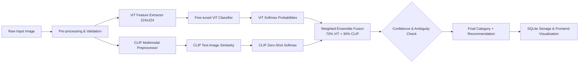

# EcoSort AI — System Architecture Specification

## 1. Executive Summary

EcoSort AI is an academic and production-grade waste classification system that classifies discarded materials into six standard recycling streams:
1. **Cardboard**
2. **Glass**
3. **Metal**
4. **Paper**
5. **Plastic**
6. **Trash**

To overcome single-model limitations (overfitting to visual artifacts in fine-grained classes like plastic vs. glass), the system employs a **dual-model ensemble**:
- **Fine-tuned Vision Transformer (ViT)** (`google/vit-base-patch16-224-in21k`) provides high-accuracy feature extraction specialized on dataset-specific waste textures and shapes.
- **Zero-shot Foundation Model (CLIP)** (`openai/clip-vit-base-patch32`) provides robust semantic generalization using multimodal contrastive learning across natural language category descriptions.

---

## 2. Pipeline Flow



---

## 3. Component Details

### 3.1 Data Flow & Image Preprocessing
- Upload validation verifies MIME type (`image/jpeg`, `image/png`, `image/webp`, `image/bmp`) and file size ($\le 10$ MB).
- Pillow converts image to RGB (stripping alpha channels and color profiles).
- ViT normalization uses ImageNet statistics: mean $[0.485, 0.456, 0.406]$, std $[0.229, 0.224, 0.225]$.

### 3.2 ViT Branch
- Base checkpoint: `google/vit-base-patch16-224-in21k`
- Classification head replaced with a linear layer projecting to 6 logits.
- Softmax outputs class probability distribution $P_{\text{ViT}}$.

### 3.3 CLIP Foundation Model Branch (Phase 5)
- Checkpoint: `openai/clip-vit-base-patch32`
- Architecture: 12-layer Vision Transformer + 12-layer Text Transformer mapping into a shared 512-dimensional joint multimodal latent space.
- Zero-shot classification: Computes cosine similarity between input image embeddings and the 6 target class prompts:
  1. `cardboard`: *"a photo of a cardboard box or cardboard waste"*
  2. `glass`: *"a photo of a glass bottle or glass container"*
  3. `metal`: *"a photo of a metal can or metallic object"*
  4. `paper`: *"a photo of paper waste or newspaper"*
  5. `plastic`: *"a photo of a plastic bottle or plastic bag"*
  6. `trash`: *"a photo of general household trash or garbage"*
- Temperature-scaled softmax outputs normalized probability distribution $P_{\text{CLIP}}$.
- Lifecycle: Loaded once at application startup into `ModelRegistry` and kept in memory for inference; reports HTTP 503 if unavailable.

### 3.4 Fusion Engine (Phase 6 Target)
> [!NOTE]
> ViT + CLIP weighted ensemble fusion is implemented in **Phase 6**. In Phase 5, both models operate independently with their dedicated pipelines, preparing the infrastructure for Phase 6 weighted probability blending:
- Default weights: $W_{\text{ViT}} = 0.70$, $W_{\text{CLIP}} = 0.30$.
- Fused probability:
  $$P_{\text{ensemble}}(c) = W_{\text{ViT}} \cdot P_{\text{ViT}}(c) + W_{\text{CLIP}} \cdot P_{\text{CLIP}}(c)$$
- Argmax selects predicted category; max selects confidence.
- Ambiguity flag triggers when $|P_{\text{top1}} - P_{\text{top2}}| < 0.10$.
- Low-confidence flag triggers when $P_{\text{top1}} < 0.50$.

---

## 4. Database Architecture

SQLite persistence managed through asynchronous SQLAlchemy:

```sql
CREATE TABLE predictions (
    id                  INTEGER PRIMARY KEY AUTOINCREMENT,
    filename            VARCHAR(255) NOT NULL,
    predicted_category  VARCHAR(50) NOT NULL,
    confidence          FLOAT NOT NULL,
    vit_prediction      VARCHAR(50) NOT NULL,
    clip_prediction     VARCHAR(50) NOT NULL,
    class_probabilities TEXT NOT NULL,  -- JSON string of {category: float}
    model_version       VARCHAR(20) NOT NULL,
    created_at          DATETIME NOT NULL DEFAULT CURRENT_TIMESTAMP
);
```

---

## 5. UI/UX Visual Identity

- **Theme**: EcoSort AI Design System
- **Palette**:
  - Forest Green: `#14532D`
  - Emerald Green: `#16A34A`
  - Lime Accent: `#D9F99D`
  - Background: `#F7F9F5`
  - Cards: `#FFFFFF`
- **Typography**: Manrope (Headings), Inter (Body)
